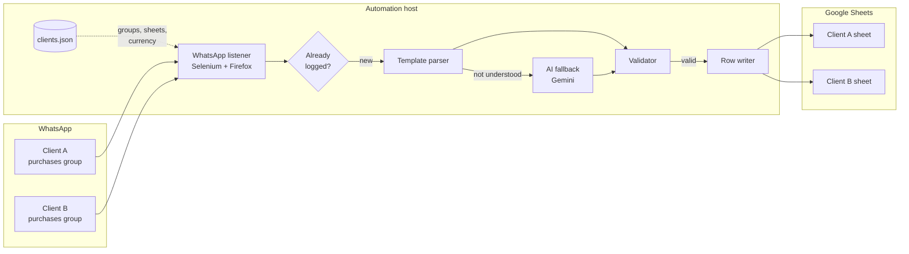
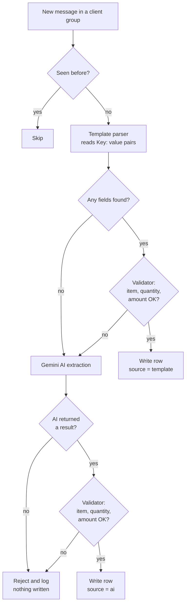
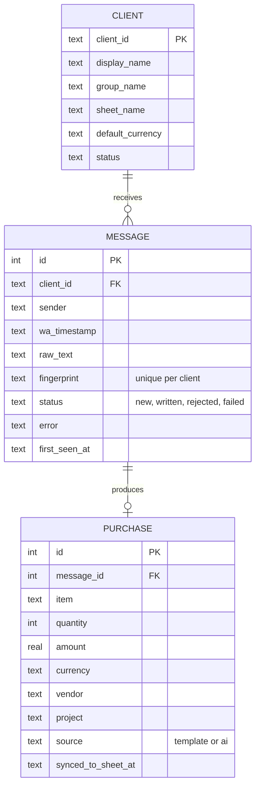
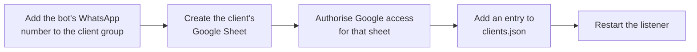

# WhatsApp Purchase Logger

**Turns the purchase messages your team already sends on WhatsApp into a clean, structured Google Sheet. No new app, no manual retyping.**


---

## Table of contents

- [The problem](#the-problem)
- [What it does](#what-it-does)
- [Example](#example)
- [Features](#features)
- [How it works](#how-it-works)
  - [System architecture](#system-architecture)
  - [Message processing flow](#message-processing-flow)
  - [Component map](#component-map)
- [Data model](#data-model)
- [Multi-client setup](#multi-client-setup)
- [Getting started](#getting-started)
- [Configuration reference](#configuration-reference)
- [Testing](#testing)
- [Security and privacy](#security-and-privacy)
- [Limitations](#limitations)
- [Roadmap](#roadmap)

---

## The problem

Small businesses already run their day-to-day buying through WhatsApp groups. Someone buys cables, paper or a software subscription and posts it in the group. At the end of the week or month, someone else scrolls back through the chat and retypes every purchase into a spreadsheet.

That process is slow, error-prone and depends on one person remembering to do it.

## What it does

The system watches a chosen WhatsApp group. When a team member posts a purchase, it:

1. Reads the message.
2. Extracts the item, quantity, amount, currency, vendor and project.
3. Checks that the data makes sense (quantity is a whole number above zero, amount is a positive number, and so on).
4. Adds a new row to the business's Google Sheet, with the original message kept alongside for auditing.

Messages that are not purchases, or that cannot be understood reliably, are **not** written to the sheet.

## Example

A team member posts this in the group:

```text
Item: Printer paper
Quantity: 5
Amount: 450
Vendor: Office World
Project: Head office
```

A new row appears in the sheet:

| Timestamp | Sender | Item | Quantity | Amount | Currency | Vendor | Project | Source | Raw message |
|---|---|---|---|---|---|---|---|---|---|
| 1:00 pm, 01/08/2026 | Ahmed | Printer paper | 5 | 450.0 | EGP | Office World | Head office | template | Item: Printer paper ... |

Messages that do not follow the template, contain typos, or are written in Egyptian Arabic are passed to an AI extraction step. For example, all of these are understood:

```text
Itm: Cable  Qiantity: 3  Amout: 90  Vendor: ElectroShop
الصنف: كابل  الكمية: 3  السعر: 90
bought 2 items of paper for 450 from Office World
```

Rows created by the AI step are marked `ai` in the **Source** column, so they are easy to review.

---

## Features

| Feature | Status |
|---|---|
| Live monitoring of WhatsApp groups through WhatsApp Web | Available |
| Template parser for `Key: value` messages | Available |
| AI fallback (Google Gemini) for typos, free text and Egyptian Arabic | Available |
| Validation layer applied to both template and AI results | Available |
| Per-client default currency | Available |
| Several clients served from one running instance (`clients.json`) | Available |
| Duplicate protection against messages already logged | Available |
| Safety check that the open chat is the expected group before reading | Available |
| Source column (`template` / `ai`) and raw message kept for audit | Available |
| Local database for history, retries and reporting | Planned |
| Automatic browser crash recovery | Planned |
| Purchase categorisation | Planned |
| Subscription plans and usage tracking | Planned |

---

## How it works

### System architecture



One browser session, logged in to a single WhatsApp account that is a member of every client's group, cycles through the groups listed in `clients.json`. Each client's purchases are written only to that client's sheet.

### Message processing flow



The validator sits behind **both** paths. AI output is never written to a sheet without passing the same checks as a hand-typed template.

### Component map

| File | Responsibility |
|---|---|
| `whatsapp_listener.py` | Entry point. Starts Firefox with a persistent profile, opens each client's group, verifies the chat header matches the expected group, reads messages and skips ones already logged. |
| `main.py` | Orchestrates one message: parser, then validator, then AI fallback if needed, then writes the row. |
| `parser.py` | Deterministic extraction of `Key: value` pairs. No network, no AI. |
| `ai_fallback.py` | Calls Gemini with a fixed JSON schema. Paces calls and retries on rate limits. |
| `validator.py` | Checks required fields, types and ranges, and returns clean typed data or a clear error. |
| `Sheets_connector.py` | Google authentication and access to a client's worksheet. |
| `logger.py` | File logging setup. |
| `clients.json` | One entry per client: group, sheet, worksheet, Google token, default currency. |
| `test_*.py` | Script-style checks for the parser, validator and AI fallback. |

---

## Data model

### Google Sheet (current output)

Each valid purchase becomes one row, in this column order:

| # | Column | Type | Notes |
|---|---|---|---|
| A | Timestamp | text | WhatsApp timestamp, e.g. `1:00 pm, 01/08/2026` |
| B | Sender | text | Display name as shown in WhatsApp |
| C | Item | text | Translated to English when the AI step handles Arabic |
| D | Quantity | integer | Must be greater than 0 |
| E | Amount | number | Must be greater than 0 |
| F | Currency | text | From the message, otherwise the client's default |
| G | Vendor | text | Optional |
| H | Project | text | Optional |
| I | Source | text | `template` or `ai` |
| J | Raw message | text | Original message, kept for auditing |

### Local database (planned)

A local SQLite database will record every message the system sees, what happened to it, and whether it reached the sheet. This allows retries when Google Sheets is unavailable, a visible list of rejected messages, and usage figures per client.



---

## Multi-client setup

All clients share the same code. What differs per client lives in `clients.json`:

```json
[
  {
    "client_id": "client_001",
    "group_name": "Acme Purchases",
    "sheet_name": "Acme Purchases 2026",
    "worksheet_name": "Raw Data",
    "token_file": "tokens/token_client_001.json",
    "default_currency": "EGP"
  }
]
```

Adding a client:



---

## Getting started

### Prerequisites

- Windows with Python 3.14 (other recent Python 3 versions are likely to work but are untested)
- Mozilla Firefox
- A WhatsApp account that is a member of each client group
- A Google Cloud project with the Google Sheets and Google Drive APIs enabled, and an OAuth client of type **Desktop app**
- A Gemini API key (only needed for the AI fallback)

### Installation

```powershell
git clone https://github.com/BavlyWilliam/Whatsapp-accounting-automation.git
cd Whatsapp-accounting-automation

python -m venv .venv
.\.venv\Scripts\Activate.ps1
pip install -r requirements.txt
```

### Secrets

These files stay on the machine and are excluded from Git:

| File | What it is |
|---|---|
| `credentials.json` | Google OAuth client (identifies the app) |
| `tokens/token_<client_id>.json` | Google access for one client, created on first run |
| `.env` | `GEMINI_API_KEY=...` |

### First run

```powershell
python whatsapp_listener.py
```

1. Firefox opens WhatsApp Web. Scan the QR code with the bot's phone once. The session is kept in the local Firefox profile folder.
2. A browser tab opens for Google sign-in for each client without a token yet. Approve access.
3. The listener loads existing rows from each sheet, then starts watching the groups. Activity is logged to `logs/main.log`.

---

## Configuration reference

| Key | Required | Description |
|---|---|---|
| `client_id` | Yes | Short unique ID, used in logs and file names |
| `group_name` | Yes | Exact WhatsApp group name, as shown in the chat header |
| `sheet_name` | Yes | Google Sheet name |
| `worksheet_name` | Yes | Tab inside the sheet that receives rows |
| `token_file` | Yes | Path to this client's Google token file |
| `default_currency` | No | Used when a message has no currency. Defaults to `EGP` |

### Message template

Field names are case-insensitive. `Item`, `Quantity` and `Amount` are required; the others are optional.

```text
Item: <what was bought>
Quantity: <whole number>
Amount: <price, numbers only>
Currency: <EGP, USD, ...>
Vendor: <shop or supplier>
Project: <project or job>
```

---

## Testing

The current checks are scripts that print their results:

```powershell
python test_praser.py
python test_validator.py
python test_ai_fallback.py   # calls the Gemini API; uses a fake sheet, writes nothing
```

`test_ai_fallback.py` replaces Google Sheets with a fake object, so no real sheet is modified, but it does make real Gemini API calls.

---

## Security and privacy

- Google credentials, tokens, the `.env` file, browser profiles, logs and runtime state are listed in `.gitignore` and must never be committed.
- The WhatsApp session lives in a local Firefox profile folder. Anyone with that folder can access the linked WhatsApp account, so treat it like a password.
- Only the configured groups are read. Before reading, the listener checks that the open chat's header matches the expected group name and stops if it does not.
- Each client's purchases go only to that client's sheet.
- Message text is sent to Google Gemini only when the template parser cannot handle it.

---

## Limitations

- **WhatsApp Web automation.** The system controls WhatsApp Web through a browser rather than through the official WhatsApp Business Platform. Changes to WhatsApp Web's page structure can require maintenance, and WhatsApp's terms restrict unofficial automated access, so a dedicated number is recommended for the bot account.
- **One machine, one browser.** Groups are checked one after another. Response time grows as clients are added, and if the browser crashes, all clients pause until it restarts.
- **Minute-level timestamps.** WhatsApp Web shows times to the minute. Two identical messages from the same person within the same minute are treated as one.
- **Recent messages only.** The listener reads the messages WhatsApp Web has loaded on screen; it does not import a full chat export.

---

## Roadmap

- [ ] SQLite storage layer: message history, rejected-message list, retry queue for failed sheet writes
- [ ] Bounded, logged browser crash recovery
- [ ] Purchase categories from a fixed per-client list, with `Uncategorized` as a fallback
- [ ] Automated tests with `pytest` and mocked WhatsApp, Gemini and Sheets
- [ ] Configuration validation at startup with clear error messages
- [ ] Client onboarding script
- [ ] Subscription plans and per-client usage reporting
- [ ] Evaluate migration to the official WhatsApp Business Platform (Cloud API) for larger deployments

---

## Author

Built by **Bavly William**. For a demo or to set this up for your business, contact me through my GitHub profile: [@BavlyWilliam](https://github.com/BavlyWilliam).
